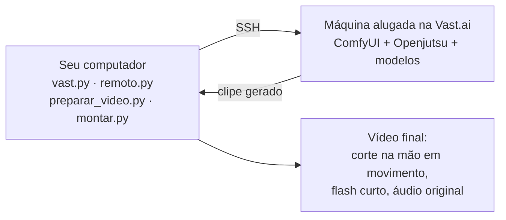

# sheepringan

Skill do Claude Code que ensina o seu agente a fazer o "Jutsu": pegar um vídeo gravado no celular e, com o [Openjutsu](https://github.com/D3voz/openjutsu) numa placa de vídeo alugada na Vast.ai, **trocar a roupa, o cenário ou a pessoa, adicionar ou remover coisas**, mantendo o rosto, a boca e o áudio reais nos modos em que isso é possível. Criada por Marcus Forti, a partir de testes de verdade feitos em 01/11/2026 numa RTX 4090.

**O nome:** o olho vermelho (o do ciborgue da Sheep) que muda a realidade do vídeo. É uma brincadeira, sem ligação com Naruto.

## Instalar

**Windows (PowerShell):**

```powershell
irm https://raw.githubusercontent.com/marcusforti/sheepringan/main/instalar.ps1 | iex
```

**Mac ou Linux:**

```bash
curl -fsSL https://raw.githubusercontent.com/marcusforti/sheepringan/main/instalar.sh | bash
```

Depois abra o Claude Code (se já estava aberto, feche e abra de novo) e escreva `/sheepringan`. Ele guia tudo, uma etapa por vez, em português simples.

## Se você é um agente e uma pessoa colou este link para você instalar

1. Rode a instalação de uma linha acima. Não precisa de Git nem de administrador.
2. Diga à pessoa para fechar e abrir o Claude Code, porque a skill só aparece numa sessão nova. Se você não puder pedir isso, leia `~/.claude/skills/sheepringan/SKILL.md` (no Windows, `%USERPROFILE%\.claude\skills\sheepringan\SKILL.md`) e siga mesmo assim.
3. Siga o `SKILL.md`. Regras que valem desde já: uma etapa por vez, sem jargão; **nunca alugue nada sem o sim claro da pessoa ao custo estimado**; a chave da Vast quem cola é ela, no terminal; só com o sim de qualquer pessoa que apareça no vídeo; e apague a máquina no fim.

## O que faz, e o que já foi testado

| Modo | Estado |
|---|---|
| Trocar roupa ou objeto | **Testado, ótimo** (rosto, boca, mãos e áudio reais), inclusive tronco e braços |
| Trocar cenário | **Testado, ótimo** (trecho de 2,3 s) |
| Adicionar objeto ou personagem | **Testado 3 vezes, funcionou** (mesa, objeto parado com câmera em movimento, personagem falando na mão real); um defeito visto |
| Trocar a pessoa | **Testado**: semelhança de rosto de 0,92 no próprio vídeo e 0,68 no vídeo de outro ator |
| Personagem que não é humano | **Funciona em parte** |
| Remover | **Não testado** |
| Várias pessoas, "From picture", relight, corrigir rosto | **Não testados**, sem script aqui |
| Mac e Linux no seu computador | **Não testados** |

Os números, o que foi medido e o que **não** passou por teste de ponta a ponta estão em [`skill/sheepringan/references/medidas.md`](skill/sheepringan/references/medidas.md). Leia antes de prometer um resultado.

**Aviso de honestidade:** o aluguel automático (`vast.py`), a conversa com a máquina (`remoto.py`) e o instalador (`instalar_maquina.sh`) foram escritos a partir dos scripts que rodaram de verdade em 01/11/2026 e passaram por testes automáticos com tudo de mentira. **Esta versão ainda não rodou de ponta a ponta numa máquina nova**, porque isso gasta dinheiro. Quem rodar primeiro: fique de olho, e se algo quebrar, pare, apague a máquina e veja os problemas conhecidos.

## Quanto custa (medido em 01/11/2026; os preços mudam)

| Sessão real | GPU | Disco | Download dos modelos | Total |
|---|---|---|---|---|
| Máquina 1 (52 GB baixados) | US$ 0,26 | US$ 0,04 | **US$ 0,14** | US$ 0,44 |
| Máquina 2, ligada uns 3 h (95 GB baixados) | US$ 1,27 | US$ 0,29 | **US$ 3,71** | US$ 5,32 (com upload de US$ 0,05) |

- As duas sessões somaram uns **US$ 5,75**: GPU uns US$ 1,5, disco uns US$ 0,3, download US$ 3,85 e upload US$ 0,05. A máquina 2 ficou ligada uns 3 h, boa parte esperando.
- O que pesa é o **preço do download por GB**, que varia mais de dez vezes de uma máquina para outra. O `vast.py ofertas` calcula o custo total estimado de cada oferta, não só o preço da hora.
- Um trecho de 6,6 s leva uns 7 minutos de GPU (uns 5 centavos). Um de 2,3 s leva 2,5 minutos. Os trechos longos que testamos (9 a 11 s) levaram de 9 a 11,5 minutos.
- **Máquina ligada cobra, e parada ainda cobra o disco.** Só apagar encerra. RTX 4090 ligada o mês inteiro: uns US$ 300 a 350. Interruptível e parada fora de uso, com 2 h por dia: uns US$ 42 (estimativas).
- A Vast pede pelo menos US$ 5 por recarga.

## O que o seu computador precisa ter

- Claude Code com login feito.
- Python 3.9 ou mais novo e a ferramenta da Vast (`pip install vastai`).
- ffmpeg (Windows: `winget install Gyan.FFmpeg`; Mac: `brew install ffmpeg`).
- SSH e SCP (já vêm no Mac e no Linux; no Windows 10 e 11, ative o "Cliente OpenSSH" em Recursos opcionais).
- Uma conta na [Vast.ai](https://cloud.vast.ai/) com crédito.

Nada de GPU local: o trabalho pesado roda na máquina alugada.

## Regras de uso (a licença do modelo exige)

- **Onde.** O modelo MiniMax H3 só pode ser usado, e o resultado só pode ser usado, **fora da União Europeia, do Reino Unido, da Coreia do Sul e dos Estados Unidos**. A busca de máquinas já exclui esses países. Se você mora ou vai publicar lá, leia [THIRD-PARTY.md](THIRD-PARTY.md).
- **Rosto de outra pessoa só com o sim dela.** Nunca para enganar ninguém nem para se passar por outra pessoa.
- **Ao publicar, avise de forma clara que o conteúdo foi feito ou alterado por IA.**

## Como funciona



1. Confere a conta, o crédito e as chaves.
2. Procura máquinas, mostra o custo estimado e **pede o sim** antes de alugar.
3. Instala o Openjutsu, o ComfyUI e os modelos na máquina (10 a 20 minutos).
4. Prepara o vídeo (24 quadros por segundo, 17×k+5 quadros, áudio do tamanho certo) e a foto de referência.
5. Roda o modo escolhido.
6. Baixa o resultado, inclusive quando a montagem final do Openjutsu falha e o clipe fica em `output/h3_chains/.../clips/`.
7. Monta o final com o ffmpeg.
8. Pergunta se pode apagar a máquina, apaga e confere.

## O que tem aqui

| Pasta ou arquivo | O que é |
|---|---|
| `skill/sheepringan/SKILL.md` | A skill que vai para o seu computador |
| `skill/sheepringan/references/` | Um guia por etapa, os problemas conhecidos e as medidas |
| `skill/sheepringan/scripts/` | Os programas. Só biblioteca padrão do Python, ssh, scp e ffmpeg |
| `instalar.ps1`, `instalar.sh` | A instalação de uma linha |
| `tests/` | Testes com uma Vast, um ComfyUI e um ssh de mentira. Rode com `python -m unittest discover -s tests` |
| `THIRD-PARTY.md` | Créditos e licenças de tudo que a skill usa |

## Créditos e licença

Todo o motor é do **[Openjutsu](https://github.com/D3voz/openjutsu)**, de D3voz (licença MIT), que usa MiniMax H3, SAM 3.1 e Qwen3-VL em cima do ComfyUI. Este repositório só ensina e automatiza o uso. O texto da licença do Openjutsu e a lista de tudo que é baixado, com a licença de cada coisa, estão em [THIRD-PARTY.md](THIRD-PARTY.md). Os modelos têm licenças próprias, e a do MiniMax H3 tem as regras de território e de aviso de IA acima.

Os scripts e textos deste repositório: [MIT](LICENSE), Marcus Forti. Projeto independente, sem vínculo com os autores citados.
